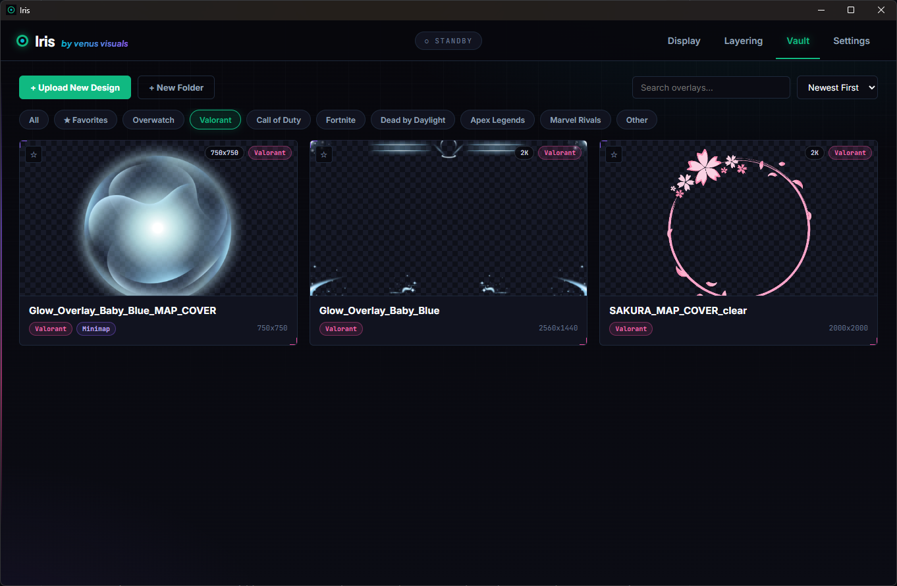
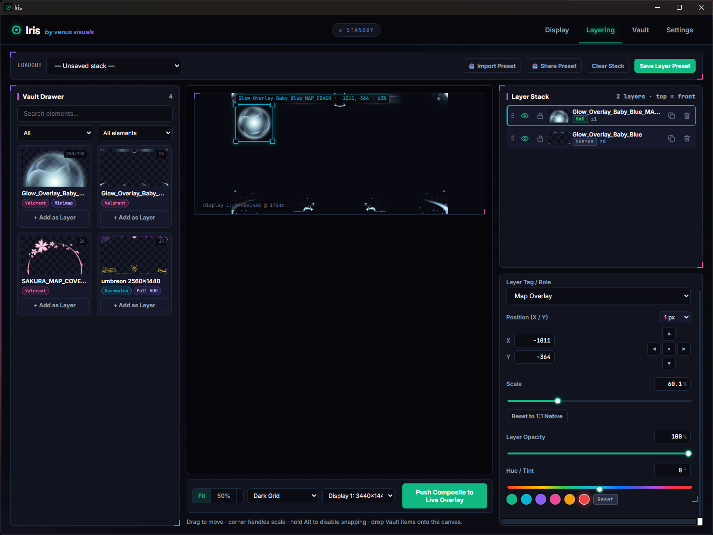
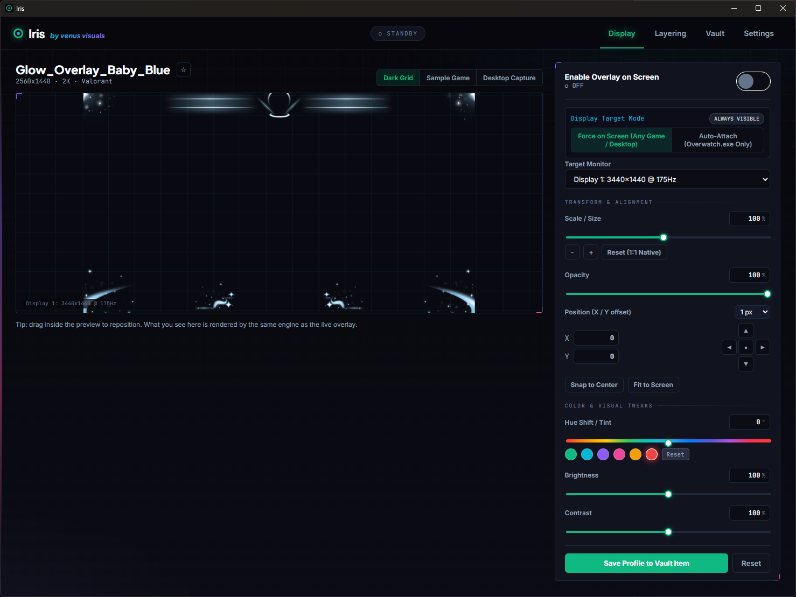
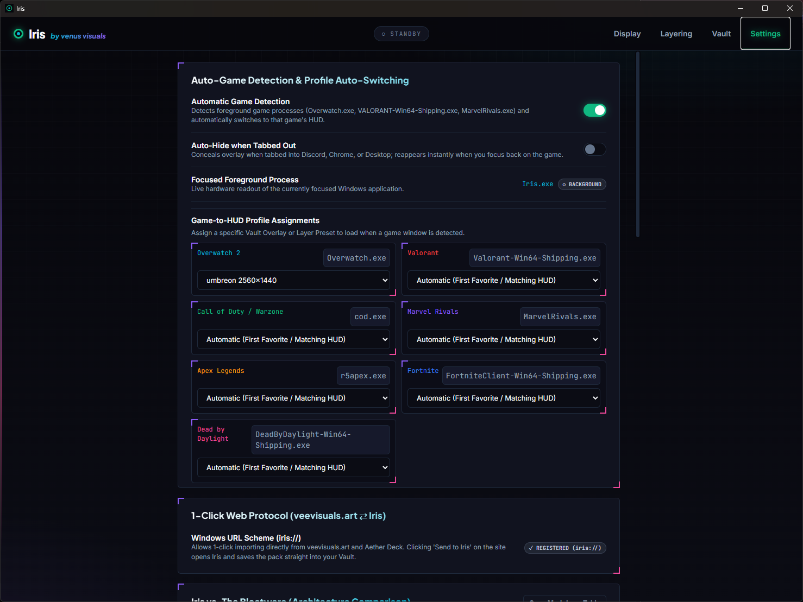

# Iris

A zero-overhead, anti-cheat safe desktop overlay and modular HUD compositor for Windows.

Iris renders high-resolution transparent PNG and WebP overlays directly over borderless and windowed games with near-zero resource consumption. It is engineered as a standalone native utility built with Rust, Tauri 2, and React.

---

## Architectural Principles

Traditional game overlay tools (such as Overwolf, Discord Overlay, or RivaTuner Statistics Server) rely on DLL injection, DirectX/Vulkan swapchain hooking, or process memory inspection to draw graphics inside the game pipeline. This approach introduces input latency, destabilizes frame pacing, and frequently triggers anti-cheat false positives.

Iris operates on an entirely external, non-invasive model:

- **Zero DLL Hooking:** Never injects code into foreign game processes.
- **Zero Memory Reading:** Does not inspect, read, or modify game memory address spaces.
- **Native OS Compositing:** Employs Win32 hardware-accelerated layered topmost windows (`WS_EX_LAYERED | WS_EX_TRANSPARENT | WS_EX_TOPMOST | WS_EX_NOACTIVATE | WS_EX_TOOLWINDOW`).
- **Anti-Cheat Safe:** Inherently compatible with Riot Vanguard, Easy Anti-Cheat, BattlEye, and Ricochet, operating with the same security profile as a native Windows notification or taskbar flyout.
- **Click-Through Transparency:** Mouse and keyboard inputs pass completely through the overlay directly into the game window with zero intercept delay.
- **Streamer Privacy (`WDA_EXCLUDEFROMCAPTURE`):** Native Windows Display Affinity allows the overlay to remain visible on the player's physical monitor while being entirely omitted from OBS Studio, Discord screen shares, and Game Capture hooks.

---

## Interface Overview

### Vault (Asset & Profile Management)


The Vault serves as a centralized digital asset repository for all transparent overlays, organized by game category (Overwatch 2, Valorant, Marvel Rivals, Apex Legends, Dead by Daylight, and Custom titles).
- Instant multi-category filtering, keyword search, and favorites pinning.
- Per-item persistent calibration profiles (X/Y coordinates, scale, opacity, hue, brightness, and contrast).
- Double-click to instantly engage an overlay into live play.

---

### Layering Studio (Modular HUD Compositor)


A multi-layer composition workspace for stacking, transforming, and synchronizing complex HUD packages.
- Visual positioning canvas with edge and center snapping guides.
- Layer stack management: reordering, grouping by HUD roles (reticles, minimaps, status frames, ult meters), duplication, and visibility toggling.
- Reference schematic backdrops to calibrate layout alignments against game UI proportions.
- Single-click deployment of the entire composite stack to the live overlay canvas.

---

### Display Controller (Targeting & Compositing)


Direct control over monitor selection, scaling modes, and active overlay state.
- Physical pixel coordinate mapping (`1/devicePixelRatio`) ensuring exact 1:1 pixel rendering at 1080p, 1440p, and 4K resolutions.
- Real-time global opacity slider and topmost window layer verification.
- Active game process detection and automated profile switching.

---

### Settings & Streamer Configuration


Low-level application parameters and execution toggles.
- Global system hotkeys: instant overlay show/hide toggle (default F10), previous/next asset cycling, and role-based layer activation.
- Streamer Mode toggle utilizing `SetWindowDisplayAffinity`.
- Hardware acceleration toggle passing `--disable-gpu` flags to the underlying WebView2 compositing instance when minimizing GPU usage is paramount.
- Low-Resource Mode reducing background process polling frequency.

---

## Technical Specifications

| Parameter | Specification |
| :--- | :--- |
| **Operating System** | Windows 10 (Build 19041+) / Windows 11 (64-bit) |
| **Runtime Core** | Rust 1.77+ with Tauri 2 Framework |
| **Frontend UI** | React 18, TypeScript, Tailwind CSS, Vite |
| **Binary Footprint** | ~5.1 MB standalone portable executable (`Iris.exe`) |
| **Privileges Required** | Standard User (Does NOT require Run as Administrator) |
| **Supported Formats** | 32-bit Transparent PNG, Animated WebP, Static WebP with alpha channel |
| **Display Modes** | Borderless Windowed, Windowed, Fullscreen (FSO / DirectFlip) |
| **Stream Hiding** | Win32 `WDA_EXCLUDEFROMCAPTURE` (Windows 10 Version 2004+) |

---

## Codebase Structure

```
Iris/
├── index.html                  Control UI entry point
├── overlay.html                Frameless transparent click-through window entry point
├── src/
│   ├── App.tsx                 Application state coordinator and tab navigation
│   ├── api.ts                  Type-safe Tauri IPC bridge invokes
│   ├── layers.ts               Composite stack algorithms and transform math
│   ├── overlay.tsx             High-performance single-canvas composition renderer
│   ├── OverlayLayer.tsx        DOM preview renderer for single asset inspector
│   ├── types.ts                Shared TypeScript data contracts and manifests
│   ├── util.ts                 Search indexers, sorting routines, and file helpers
│   ├── styles.css              Dark matte Venus Visuals design tokens
│   └── components/
│       ├── Display.tsx         Display targeting and monitor configuration view
│       ├── Layering.tsx        Multi-track HUD layering studio canvas
│       ├── LayerDrawer.tsx     Drawer selector for adding assets into stack
│       ├── LayerPanel.tsx      Layer properties, z-index, and transform sliders
│       ├── SceneView.tsx       Interactive viewport with drag-to-position anchors
│       ├── Settings.tsx        Global hotkeys, streamer mode, and storage management
│       ├── TopBar.tsx          App header, active game badge, and tab switcher
│       └── Vault.tsx           Digital asset library grid, filters, and card actions
└── src-tauri/
    ├── Cargo.toml              Rust dependencies and optimization profile
    ├── tauri.conf.json         Window declarations and security permissions
    └── src/
        ├── main.rs             Application bootstrap, WebView2 flags, lifecycle events
        ├── win32.rs            Win32 API bindings: styles, placement, affinity, refresh rates
        ├── overlay.rs          Overlay window lifecycle, click-through, and canvas sync
        ├── vault.rs            Atomic JSON manifest persistence and asset caching
        ├── system.rs           Global keyboard hooks, process monitors, display enumeration
        └── model.rs            Rust data models matching frontend TypeScript types
```

---

## Local Development & Compilation

### Prerequisites
1. **Rust:** Current stable toolchain (`rustup default stable`)
2. **Node.js:** Node.js 18 or higher with `npm`
3. **WebView2 Runtime:** Installed natively on Windows 10/11
4. **C++ Build Tools:** Visual Studio C++ Build Tools or MSVC toolchain

### Development Mode
```powershell
npm install
npm run tauri dev
```

### Production Build
```powershell
npm run tauri build
```
The optimized portable binary will be generated at `src-tauri/target/release/Iris.exe`. Release profiles are configured with Link-Time Optimization (`lto = true`), symbol stripping (`strip = true`), single codegen units, and abort-on-panic to minimize binary size and latency.

---

## Data Storage

Application data is stored atomically in `%APPDATA%\art.veevisuals.iris\`:
- `vault_manifest.json`: Asset metadata, folder hierarchies, and layer presets.
- `settings.json`: User keybindings, monitor selections, and display preferences.
- `vault_assets/`: Scaled transparent graphics stored locally.
- `vault_thumbs/`: Pre-rendered high-performance UI thumbnails.

---

## License & Credits

Engineered for [Venus Visuals](https://veevisuals.art). Distributed under the MIT License.
