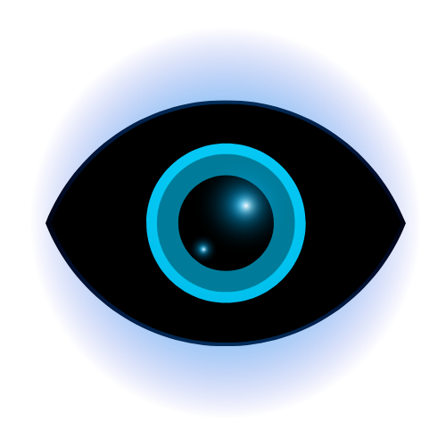

<div align="center">

  

  # Iris
  ### The Sleek, Lightweight HUD & Overlay Companion for Windows

  <p>
    <b>Customize your favorite games with custom HUDs, aesthetic stream overlays, reticles, and UI packs.</b><br>
    Zero input lag • 100% click-through • 100% anti-cheat safe.
  </p>

  <p>
    <a href="https://github.com/allnighter51/Iris/releases/latest">
      
    </a>
    <a href="https://github.com/allnighter51/Iris/releases">
      
    </a>
    <a href="https://github.com/allnighter51/Iris/blob/main/LICENSE">
      
    </a>
    <a href="https://veevisuals.art/iris">
      
    </a>
  </p>

  <p>
    <a href="#-quick-start-in-60-seconds"><b>🚀 Quick Start</b></a> •
    <a href="#-why-gamers--streamers-love-iris"><b>✨ Features</b></a> •
    <a href="#-supported-games"><b>🎮 Games</b></a> •
    <a href="#-frequently-asked-questions"><b>❓ FAQ</b></a> •
    <a href="#-for-developers--power-users"><b>🛠️ Developers</b></a>
  </p>

</div>

---

## 💡 What is Iris?

Have you ever wanted an aesthetic health bar, a personalized anime ult icon, a high-visibility crosshair, or a full streamer HUD pack over games like **Valorant**, **Overwatch 2**, **Marvel Rivals**, or **Apex Legends** — but didn't want to risk game bans or FPS drops?

**Iris makes it effortless.**

Think of Iris as a high-tech digital sticker placed seamlessly over your monitor. It displays crisp, high-resolution transparent `.png` and `.webp` graphics right where you want them on screen. Mouse clicks and keyboard presses pass right through without delay, keeping your gameplay smooth, responsive, and distraction-free.

---

## ✨ Why Gamers & Streamers Love Iris

### 🛡️ 100% Anti-Cheat Safe
Iris **never** injects code into your games, never modifies game files, and never reads game memory. It works as an external, hardware-accelerated Windows topmost display layer — exactly like the Windows volume slider or Discord notifications. It is safe to use with **Riot Vanguard, Easy Anti-Cheat, BattlEye, and Ricochet**.

### 🎯 Ghost Click-Through
Shoot, flick, aim, and chat freely. Every mouse click and keystroke passes straight through the overlay directly into your game with **zero input delay**.

### 👻 Streamer Stealth Mode (OBS Hiding)
Streaming on Twitch or sharing your screen on Discord? Flip on **Hide from Capture** in Settings. The overlay stays visible on your physical monitor for you to see, while remaining **100% invisible** to OBS Studio, Discord screen share, and capture cards!

### ⚡ Feather-Light Performance
Built in high-performance native **Rust**, Iris runs quietly in the background using less than 1% CPU and negligible memory. It effortlessly supports high-refresh-rate gaming monitors (144Hz, 240Hz, 360Hz+).

### 🧠 Smart Auto-Detection
Drop in any overlay image — like `valorant_jett_ult.png` or `kiriko_healthbar.webp` — and Iris automatically detects the game category, tags the element type, and formats the name for you. No manual typing required.

### 🧩 Multi-Layer HUD Studio
Mix and match! Stack a custom reticle, an ult icon, and a health frame together into a single unified loadout with custom opacity, scaling, and position controls.

### 🚀 Auto Game-Switching
Iris automatically recognizes when you launch your favorite games and switches to your chosen HUD profile on the fly.

### 🔄 Built-in Auto-Updates
Never worry about manual downloads. Iris includes an integrated one-click updater that notifies you as soon as new releases and performance upgrades are available.

---

## 🚀 Quick Start (In 60 Seconds)

1. **Download Iris:**  
   Head to [**Releases**](https://github.com/allnighter51/Iris/releases/latest) and download `Iris.exe`. (No installer required — just download and launch!).

2. **Add Your Overlays:**  
   Drag and drop any transparent `.png` or `.webp` file into the **Vault** tab. Iris will automatically organize it by game and element.

3. **Equip & Play:**  
   Click **Equip** (or press `F10` on your keyboard) to turn the overlay on.  
   Make sure your game is set to **Borderless Windowed** or **Windowed** display mode, and you're good to go!

---

## 🎮 Supported Games

Iris works with **any PC game or application** running in Borderless or Windowed mode! It also includes pre-configured profiles and auto-detection for:

| Game | Detection Support | Popular Overlay Types |
| :--- | :---: | :--- |
| **Valorant** | ✅ Automatic | Agent Ult Icons, Ability Bars, Custom Crosshairs |
| **Overwatch 2** | ✅ Automatic | Hero Portrait Frames, Ult Meters, Health Borders |
| **Marvel Rivals** | ✅ Automatic | Character Frames, Reticles, Minimap Borders |
| **Apex Legends** | ✅ Automatic | Shield/Health Overlays, Minimap Rims, Crosshairs |
| **Call of Duty / Warzone** | ✅ Automatic | Tactical Reticles, Status Frames, Minimaps |
| **Fortnite** | ✅ Automatic | Weapon Bar Borders, Crosshair Overlays |
| **Dead by Daylight** | ✅ Automatic | Perk Icons, Portrait Borders, Status Rings |
| **Custom Games** | ✅ Fully Supported | Any borderless windowed game or desktop app! |

---

## ⌨️ Handy Hotkeys

Control your overlay without alt-tabbing out of your match:

| Hotkey | Action |
| :--- | :--- |
| **`F10`** | **Toggle Overlay ON / OFF** (instantly show or hide your HUD) |
| **`Ctrl + Alt + Right`** | **Next Overlay** (cycle through overlays in your Vault) |
| **`Ctrl + Alt + Left`** | **Previous Overlay** (cycle backwards) |
| **`Esc`** | Close dialogs, modals, and the Quick-Launch Command Center |

*(All hotkeys can be fully customized to your liking in the **Settings → Keybinds** tab!)*

---

## ❓ Frequently Asked Questions

<details>
<summary><b>Can I get banned for using Iris?</b></summary>
<br>
<b>No.</b> Traditional overlay tools inject DLLs or hook DirectX/Vulkan graphics pipelines inside the game, which can trigger anti-cheat software. Iris does neither. It creates an external, hardware-accelerated Windows display layer that sits above your screen — identical to the Windows Volume slider, Xbox Game Bar, or Windows notifications. It does not inspect, read, or modify game memory.
</details>

<details>
<summary><b>Will Iris reduce my in-game FPS?</b></summary>
<br>
<b>No measurable impact.</b> Iris is compiled natively in Rust and leverages Windows hardware-accelerated composition. When idle or projecting an overlay, CPU usage is typically well under 1%, leaving virtually all system resources dedicated to your game.
</details>

<details>
<summary><b>Why isn't the overlay showing over my game?</b></summary>
<br>
Most games default to <i>Exclusive Fullscreen</i> mode, which takes sole control of your graphics card output and blocks all desktop windows. Simply change your in-game display settings from <b>Fullscreen</b> to <b>Borderless Windowed</b> (or <i>Windowed Fullscreen</i>).
</details>

<details>
<summary><b>How does Streamer Mode (Hide from OBS) work?</b></summary>
<br>
Windows provides an official security API called <code>SetWindowDisplayAffinity</code> with <code>WDA_EXCLUDEFROMCAPTURE</code>. When enabled in Iris Settings, Windows renders the overlay directly to your physical monitor but strips it out from all screen capture pipelines (OBS Studio, Discord Screen Share, NVIDIA Shadowplay, etc.).
</details>

<details>
<summary><b>Where do I get overlays and HUD designs?</b></summary>
<br>
You can design your own transparent PNGs in Photoshop, Figma, GIMP, or Canva! You can also find curated gaming HUD packs, anime overlays, and streamer themes on <a href="https://veevisuals.art/iris"><b>veevisuals.art</b></a>.
</details>

---

## 🛠️ For Developers & Power Users

<details>
<summary><b>Click to expand architecture, folder structure, and build instructions</b></summary>

### Technical Stack
- **Backend:** Rust 1.77+ with the [Tauri v2](https://v2.tauri.app/) framework.
- **Frontend:** React 18, TypeScript, Vite, with zero runtime UI bloat.
- **Display Layer:** Win32 layered topmost window (`WS_EX_LAYERED | WS_EX_TRANSPARENT | WS_EX_TOPMOST | WS_EX_NOACTIVATE | WS_EX_TOOLWINDOW`).
- **Telemetry:** Privacy-first, anonymous session heartbeat pipeline on Supabase with zero PII and full opt-out controls.

### Repository Architecture
```
Iris/
├── src/                        React 18 + TypeScript Control Interface
│   ├── components/             Modular views: Vault, Display, Layering, Settings, TopBar
│   ├── services/               Lightweight telemetry and external integrations
│   ├── layers.ts               Multi-layer composition maths and layout transforms
│   ├── overlay.tsx             High-performance canvas compositor window
│   └── types.ts                Strict TypeScript data contracts
├── src-tauri/                  Native Rust Core
│   ├── src/
│   │   ├── main.rs             Tauri runtime initialization, system tray, single instance
│   │   ├── win32.rs            Direct Win32 API bindings (display affinity, styles, monitor enum)
│   │   ├── overlay.rs          Click-through window lifecycle and geometry management
│   │   ├── system.rs           Global low-level keyboard hooks and foreground process polling
│   │   └── model.rs            Persistent state schemas (vault_manifest.json, settings.json)
│   └── Cargo.toml              Optimized Rust release profile (LTO, strip, opt-level 3)
```

### Local Development Setup

1. **Install Prerequisites:**
   - [Rust](https://rustup.rs/) (stable toolchain)
   - [Node.js](https://nodejs.org/) (v18+)
   - Visual Studio C++ Build Tools (with Windows 10/11 SDK)

2. **Run in Development:**
   ```powershell
   npm install
   npm run tauri dev
   ```

3. **Compile Release Binary:**
   ```powershell
   npx tauri build --runner cargo-xwin --no-bundle
   ```
   The standalone, portable executable will be generated at `src-tauri/target/release/iris.exe`.

### Local Data Storage
All configurations are stored locally on your machine in `%APPDATA%\art.veevisuals.iris\`:
- `vault_manifest.json`: Your overlays, folders, and composite presets.
- `settings.json`: Your keybindings, display modes, and preferences.
- `vault_assets/`: Imported transparent overlay assets.
- `vault_thumbs/`: Auto-generated UI preview thumbnails.

</details>

---

## 💖 Community & Credits

- Designed & engineered with love for the gaming & streaming community by [**Venus Visuals**](https://veevisuals.art).
- Licensed under the [**MIT License**](LICENSE) — free and open for everyone.
